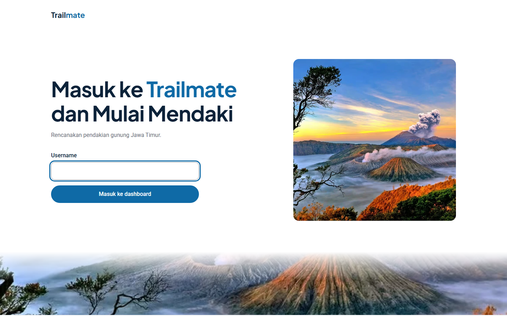
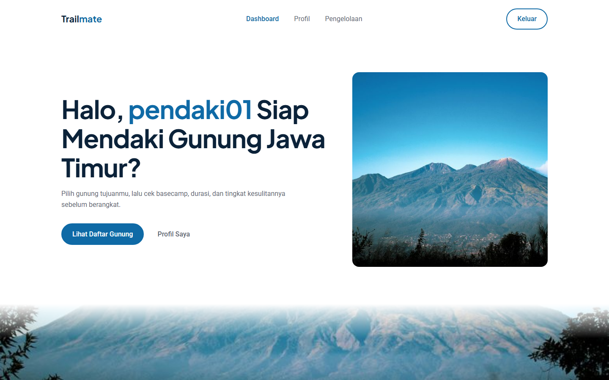
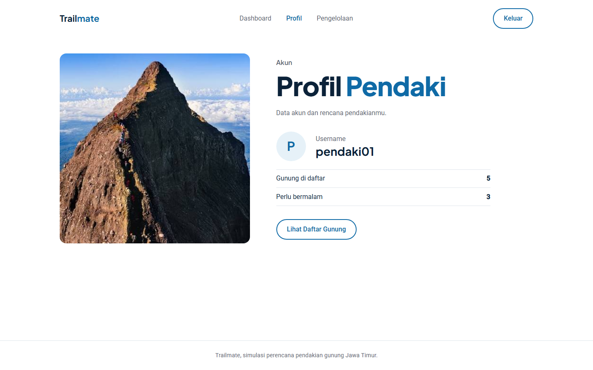
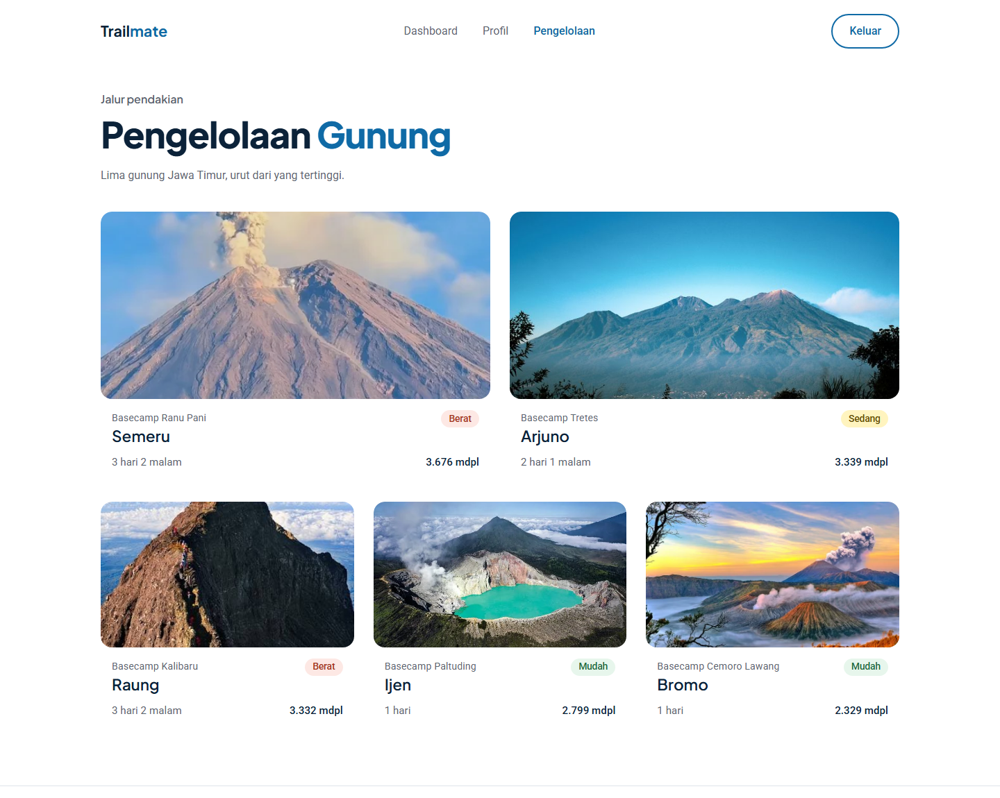
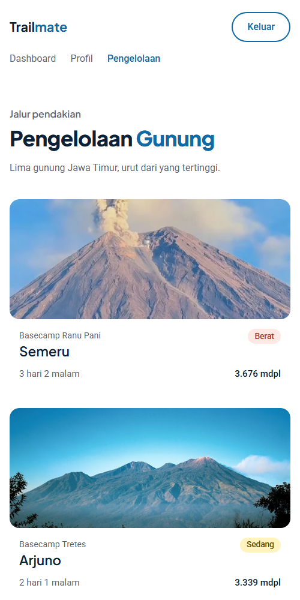

# Trailmate

UTS Pemrograman Web 2026, NIM 252410102092.

Trailmate adalah web simulasi perencana pendakian gunung di Jawa Timur. Pengguna masuk dengan username, melihat ringkasan di dashboard, membuka profil, lalu melihat daftar gunung di halaman pengelolaan beserta ketinggian, basecamp, durasi, dan tingkat kesulitannya.

Dibuat dengan Laravel 13 dan CSS biasa. Web ini tidak memakai database, CRUD, atau starter kit. Data gunung berupa contoh yang disimpan sebagai array di `PageController`.

## Screenshot

| Login | Dashboard |
| --- | --- |
|  |  |

| Profil | Pengelolaan |
| --- | --- |
|  |  |

Tampilan ponsel:



## Alur data

1. Form di halaman login mengirim `username` ke `/dashboard` sebagai request parameter.
2. `PageController` membaca `username`, lalu mengirimkannya ke view.
3. Navbar menyertakan `username` di setiap tautan, sehingga Dashboard, Profil, dan Pengelolaan tetap mengenali pengguna.
4. Halaman pengelolaan menampilkan array dari controller dengan `@foreach`.

## Menjalankan project

```bash
composer install
cp .env.example .env
php artisan key:generate
php artisan serve
```

Buka `http://127.0.0.1:8000`. Tes alur halaman dijalankan dengan `php artisan test`.
